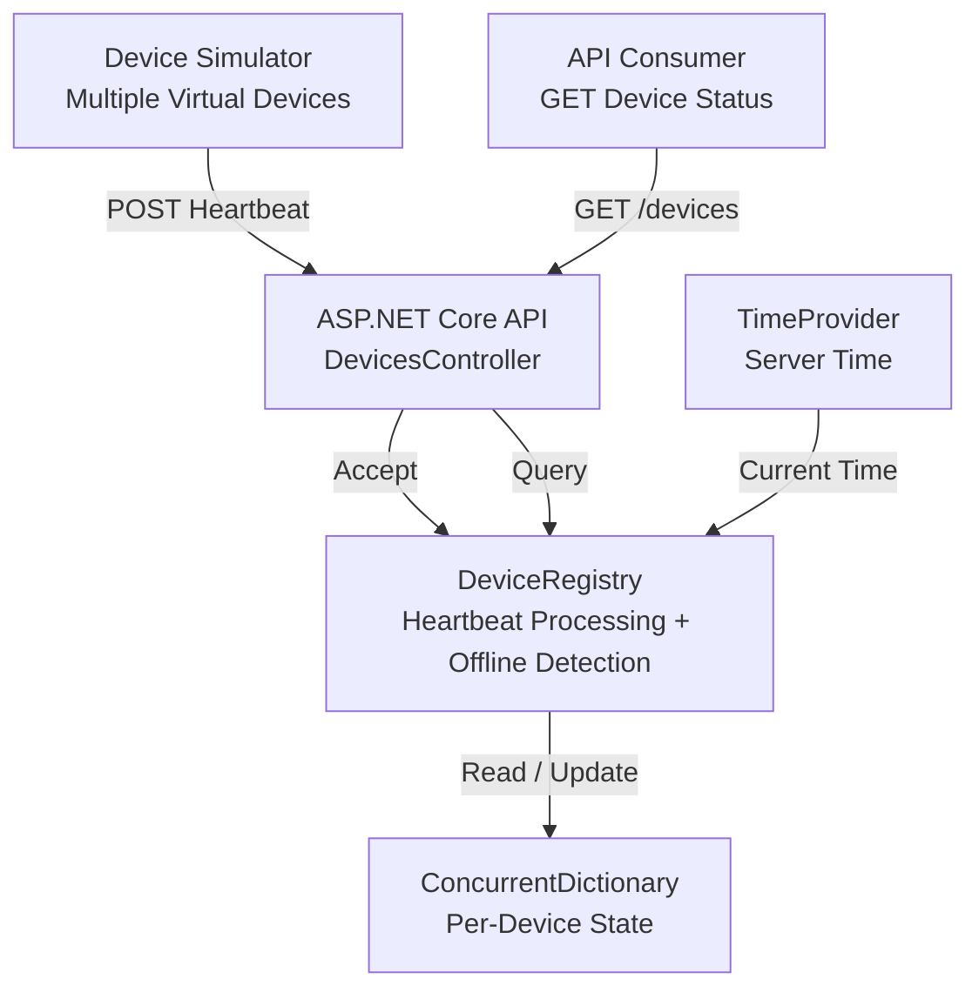

# DevicePulse Mini

**A lightweight connected-device monitoring platform built with C# and .NET 10.**

DevicePulse Mini demonstrates how a backend service can receive heartbeats from multiple connected devices, maintain their latest known state, reject duplicate and out-of-order messages, and determine whether devices are online or offline.

The project was developed as a hands-on exploration of backend architecture, concurrent state management, REST API design, automated testing, and AI-assisted software development using Claude Code.


## Architecture




The solution consists of four projects:

| Project | Responsibility |
|---|---|
| `DevicePulse.Core` | Domain models, heartbeat validation logic, device state, and offline detection |
| `DevicePulse.Api` | HTTP endpoints, request validation, dependency injection, and configuration |
| `DevicePulse.Simulator` | Simulates connected devices and sends periodic heartbeats over HTTP |
| `DevicePulse.Tests` | Unit and HTTP integration tests |

## Key Features

### Heartbeat Processing

Each device sends heartbeat messages containing a device identifier, a sequence number, and a client-generated timestamp.

The API stamps its own receive timestamp and maintains the latest accepted heartbeat for each device.

- Supports zero-based sequence numbers.
- Rejects duplicate and out-of-order messages.
- Maintains independent sequence tracking for each device.
- Returns `accepted: true` or `accepted: false` without treating valid duplicate messages as HTTP errors.

### Concurrent State Management

The application uses a `ConcurrentDictionary` for thread-safe device lookup and per-device locking to protect atomic sequence comparison and state updates.

This prevents concurrent requests from accepting the same sequence number more than once.

### Online/Offline Detection

A device is considered offline when the elapsed time since its last accepted heartbeat exceeds a configurable timeout.

Status is calculated when queried rather than maintained by a background polling process.

The implementation uses an injectable `TimeProvider`, allowing deterministic time-based tests.

### Device Simulator

The console simulator:

- Runs multiple virtual devices concurrently.
- Sends HTTP heartbeats with independent, increasing sequence numbers.
- Injects occasional duplicate and out-of-order messages.
- Reports HTTP outcomes and response times.
- Supports configurable device count and heartbeat interval.
- Handles cancellation through `Ctrl+C`.

## Technology Stack

- C# / .NET 10
- ASP.NET Core Web API
- REST / JSON
- Dependency Injection
- ConcurrentDictionary
- TimeProvider
- xUnit
- WebApplicationFactory
- FakeTimeProvider
- Claude Code for AI-assisted development

## API Endpoints

| Method | Endpoint | Description |
|---|---|---|
| POST | `/devices/{id}/heartbeats` | Process a heartbeat |
| GET | `/devices` | Retrieve all device snapshots |
| GET | `/devices/{id}` | Retrieve one device snapshot |

### Example Heartbeat Request

```http
POST /devices/device-0/heartbeats
Content-Type: application/json
```

```json
{
  "sequenceNumber": 1,
  "sentAt": "2026-11-07T08:00:00Z"
}
```

Successful processing returns:

```json
{
  "accepted": true
}
```

A duplicate or older sequence returns HTTP 200 with:

```json
{
  "accepted": false
}
```

Malformed requests return HTTP 400, and unknown devices return HTTP 404.

## Getting Started

**Prerequisite:** .NET 10 SDK

### 1. Start the API

From the repository root:

```bash
dotnet run --project src/DevicePulse.Api
```

The default development HTTP address is:

```text
http://localhost:5254
```

### 2. Start the Simulator

Open another terminal:

```bash
dotnet run --project src/DevicePulse.Simulator
```

Default behavior: three devices sending heartbeats approximately every second.

To customize the simulation:

```bash
dotnet run --project src/DevicePulse.Simulator -- --devices 5 --interval-ms 2000
```

To view the available arguments:

```bash
dotnet run --project src/DevicePulse.Simulator -- --help
```

### 3. Inspect Device Status

Request:

```http
GET http://localhost:5254/devices
```

Stop the simulator using `Ctrl+C`. After the configured offline timeout has elapsed, query the devices again to observe their transition to `Offline`.

## Automated Testing

Run all tests:

```bash
dotnet test
```

The project includes **17 passing automated tests**:

- 9 unit tests covering sequence ordering, duplicate rejection, offline boundaries, device independence, and concurrency invariants.
- 8 HTTP integration tests covering endpoint behavior, input validation, server-side timestamps, device queries, and offline recovery.

Integration tests use `WebApplicationFactory` and `FakeTimeProvider` to exercise the HTTP pipeline without relying on real-time delays.

## Configuration

The offline timeout can be configured in `src/DevicePulse.Api/appsettings.json`:

```json
{
  "DevicePulse": {
    "OfflineTimeoutSeconds": 30
  }
}
```

## Design Decisions

**In-memory registry:** Keeps the MVP focused on domain behavior and concurrency rather than infrastructure complexity.

**Per-device locking:** Makes sequence comparison and state updates atomic while allowing independent devices to be processed concurrently.

**Server-generated receive timestamps:** Prevents device-controlled timestamps from determining heartbeat freshness.

**Query-time offline detection:** Avoids requiring a background worker for the MVP's pull-based monitoring model.

**Dependency injection and TimeProvider:** Improve separation of concerns and make time-dependent behavior deterministic in tests.

## Current Limitations

- Device state is stored in memory and is lost when the API restarts.
- Simulator sequence numbers reset when the simulator restarts. For a fresh demonstration, restart both the API and simulator.
- Device status is available through HTTP queries; there are no push notifications.
- Persistence, authentication, distributed state management, and production deployment are outside the current MVP scope.

## Development Approach

This project was implemented using Claude Code as an AI-assisted development tool, with iterative planning, manual code review, bug identification, automated testing, and manual end-to-end verification.

The emphasis was on understanding and validating architectural and implementation decisions rather than solely generating code.

## Future Improvements

Potential next iterations include persistent device state, improved restart handling, real-time status notifications, richer observability, and distributed deployment.